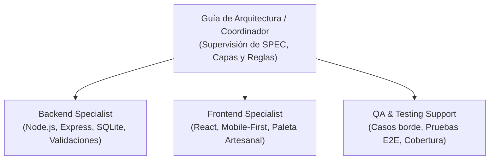

# Arquitectura de Roles de Asistencia: Carolina Sweet

Durante la construcción del proyecto, el asistente operó siguiendo el protocolo pedagógico multidisciplinario establecido en [AGENTS.md](file:///c:/Users/PC%20VIP/Documents/CarolinaSweet/AGENTS.md):

---

## 1. Roles Virtuales y Responsabilidades

### A. Guía de Arquitectura / Coordinador
- **Misión:** Asegurar que cada línea de código respete estrictamente la especificación funcional (SPEC) aprobada por la responsable.
- **Vigilancia:** Garantiza el desacoplamiento de capas (cliente independiente del servidor, servicios HTTP modulares, modelos de persistencia limpios).

### B. Backend Specialist (Node.js & SQLite)
- **Misión:** Diseñar esquemas relacionales atómicos, rutas RESTful y controladores robustos.
- **Implementación:** Manejo de consultas preparadas (`DatabaseSync.prepare()`), transacciones y validaciones financieras (límites de señas, fechas futuras).

### C. Frontend Specialist (React & CSS Artesanal)
- **Misión:** Crear una experiencia de usuario cálida, rápida y accesible para pantallas móviles en el taller.
- **Implementación:** Componentes React modulares, modales no intrusivos, controles táctiles ergonómicos y soporte fluido de paleta de colores artesanal.

### D. QA & Testing Support
- **Misión:** Garantizar que ninguna funcionalidad se entregue sin pruebas de regresión.
- **Implementación:** Diseño de suites automatizadas con `node:test`, aislamiento de base de datos de pruebas y validación de casos borde.

---

## 2. Regla Fundamental de Colaboración
> **Control Absoluto del Repositorio:** El asistente **NUNCA ejecuta `git commit` ni `git push`**. Tras completar cada tarea y verificar sus pruebas, el asistente explica los cambios, suministra los comandos exactos y espera la confirmación explícita de la desarrolladora responsable.
