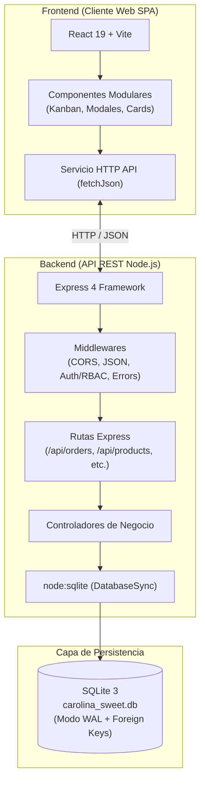

# Arquitectura del Sistema: Carolina Sweet

La arquitectura de Carolina Sweet se basa en un diseño desacoplado **Cliente-Servidor (SPA + API REST + Base de Datos Relacional)**:

---

## 1. Capa Frontend (Cliente)
- **Tecnología:** React 19 empaquetado con Vite.
- **Enfoque de diseño:** *Mobile-First* y ergonomía táctil en taller.
- **Estructura de carpetas:**
  - `src/components/`: Componentes organizados por dominio (`orders/`, `products/`, `clients/`, `dashboard/`).
  - `src/pages/`: Vistas de nivel superior (`OrdersPage`, `CatalogPage`, `ClientsPage`, `ReportsPage`).
  - `src/services/api.js`: Módulo centralizado de peticiones HTTP con manejo estandarizado de errores y URL dinámica según entorno (`import.meta.env.VITE_API_URL`).
  - `src/styles/`: CSS artesanal con variables y media queries responsivas.

---

## 2. Capa Backend (Servidor)
- **Tecnología:** Node.js v24 con framework Express 4.
- **Arquitectura interna:**
  - `app.js`: Configuración centralizada de Express, middlewares globales (CORS, JSON parser, autenticación RBAC, manejo de errores y soporte de archivos estáticos compilados para producción).
  - `routes/`: Enrutamiento modular por recurso (`orders.routes.js`, `products.routes.js`, etc.).
  - `controllers/`: Orquestación y reglas de negocio.
  - `models/`: Capa de acceso a datos y consultas parametrizadas.
  - `server.js`: Punto de entrada que ejecuta semillas iniciales y levanta el servidor en el puerto configurado.

---

## 3. Capa de Persistencia (Base de Datos)
- **Motor:** SQLite 3 nativo mediante `node:sqlite` (Node.js 24).
- **Ventajas:**
  - Cero dependencias binarias externas (no requiere compiladores C++).
  - Alto rendimiento con modo WAL (`PRAGMA journal_mode = WAL;`).
  - Integridad referencial estricta (`PRAGMA foreign_keys = ON;`).
  - Fácil respaldo y portabilidad (archivo local autónomo).
