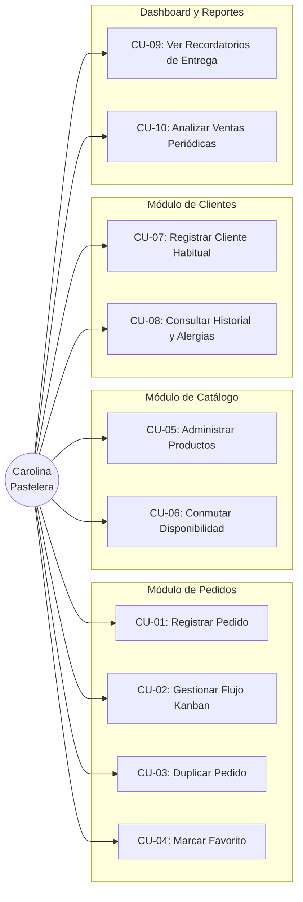

# Casos de Uso: Carolina Sweet

Los casos de uso modelan las interacciones entre los actores y el sistema de gestión:

---

## 1. Actores del Sistema
- **Carolina (Administradora / Pastelera):** Actriz principal. Gestiona pedidos, catálogo, clientes, estados en cocina y reportes de facturación.
- **Ayudante de Taller (Empleado - Preparado en RBAC):** Actor secundario futuro. Consulta el Kanban y actualiza estados de preparación sin acceso a reportes financieros.
- **Sistema Automatizado:** Tareas periódicas, recordatorios automáticos por fecha y depuración de cancelados antiguos.

---

## 2. Diagrama de Casos de Uso

---

## 3. Especificación Detallada de Casos de Uso Clave

### - Registrar Nuevo Pedido
- **Actor:** Carolina.
- **Precondición:** El servidor está en ejecución y existen productos disponibles en el catálogo.
- **Flujo Principal:**
  1. Carolina selecciona "Nuevo pedido" desde el Dashboard o la sección de Pedidos.
  2. Elige si es un cliente habitual (de la lista) o ingresa nombre y teléfono de un ocasional.
  3. Selecciona los productos del catálogo e indica las cantidades.
  4. (Opcional) Agrega concepto de adicional y su importe.
  5. Define fecha de entrega comprometida (y hora opcional).
  6. Ingresa notas del pedido (detalles de decoración, colores, texto en torta).
  7. Registra seña o anticipo si fue abonado.
  8. El sistema calcula en vivo el total y el saldo pendiente.
  9. Carolina presiona "Guardar Pedido".
  10. El sistema persiste el pedido en estado `Pendiente` y lo renderiza en el Kanban.
- **Flujos Alternativos:**
  - *Fecha en el pasado:* El sistema avisa y no permite guardar hasta corregir la fecha.
  - *Seña mayor al total:* El sistema señala el error de cálculo e impide el guardado.

### - Gestionar Flujo Kanban
- **Actor:** Carolina.
- **Flujo Principal:**
  1. Carolina visualiza las 4 columnas del Kanban.
  2. En la tarjeta correspondiente, abre el selector táctil de estado.
  3. Selecciona el nuevo estado (`En preparación`, `Listo` o `Entregado`).
  4. La tarjeta se reubica instantáneamente y los recordatorios se actualizan.
- **Flujo Alternativo (Reapertura de Entregado):**
  - Al seleccionar un estado previo desde `Entregado`, aparece un diálogo modal de confirmación.
  - Si Carolina confirma, el pedido se reabre y se limpia la fecha de entrega final.
