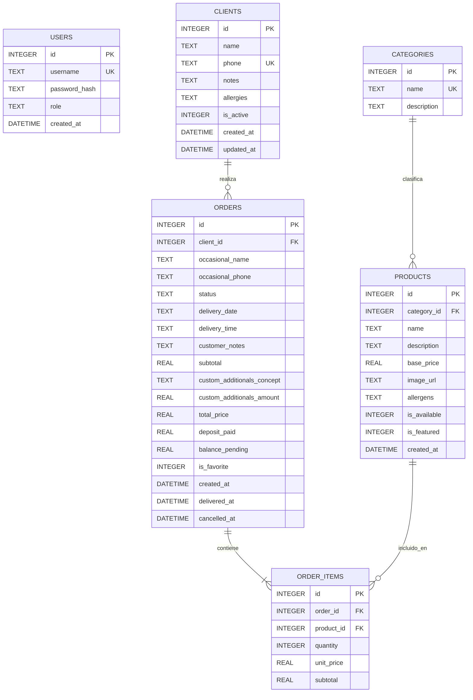

# Modelo de Datos y Entidad-Relación: Carolina Sweet

El esquema relacional de Carolina Sweet está optimizado para garantizar la integridad financiera de los pedidos y la preservación del historial de clientes y productos.

---

## 1. Diagrama Entidad-Relación (ERD)

---

## 2. Diccionario de Datos

### Tabla: `users`
- `id`: Entero, clave primaria autoincremental.
- `username`: Texto único, nombre de usuario (ej. `carolina`).
- `password_hash`: Hash seguro de la contraseña.
- `role`: Texto restringido (`'admin'`, `'employee'`).
- `created_at`: Marca temporal de creación.

### Tabla: `clients`
- `id`: Entero, clave primaria autoincremental.
- `name`: Nombre y apellido del cliente habitual.
- `phone`: Texto único (WhatsApp/celular), actúa como identificador principal.
- `notes`: Preferencias estéticas o gustos especiales.
- `allergies`: Registro de alérgenos o restricciones alimentarias.
- `is_active`: Entero (1 = Activo, 0 = Inactivo / Soft-deleted).

### Tabla: `categories`
- `id`: Entero, clave primaria autoincremental.
- `name`: Nombre de la categoría (ej. Tortas artesanales, Cupcakes).
- `description`: Descripción general del rubro.

### Tabla: `products`
- `id`: Entero, clave primaria autoincremental.
- `category_id`: Clave foránea referenciando a `categories(id)`.
- `name`: Nombre de la creación dulce.
- `description`: Ingredientes o características.
- `base_price`: Precio vigente de venta al público ($\ge 0$).
- `allergens`: Alérgenos presentes (Gluten, Lácteos, etc.).
- `is_available`: Entero (1 = Disponible para pedidos, 0 = Pausado).
- `is_featured`: Entero (1 = Destacado en catálogo, 0 = Normal).

### Tabla: `orders`
- `id`: Entero, clave primaria autoincremental.
- `client_id`: Clave foránea opcional a `clients(id)` (NULL si es ocasional).
- `occasional_name`: Nombre del cliente cuando no es habitual.
- `occasional_phone`: Teléfono de contacto ocasional (usado para vinculación HU-02).
- `status`: Estado del pedido (`'Pendiente'`, `'En preparación'`, `'Listo'`, `'Entregado'`, `'Cancelado'`).
- `delivery_date`: Fecha de entrega comprometida en formato `YYYY-MM-DD`.
- `delivery_time`: Hora aproximada de retiro o envío (`HH:MM`).
- `customer_notes`: Indicaciones de diseño y dedicatorias.
- `subtotal`: Sumatoria de ítems.
- `custom_additionals_concept`: Detalle de personalización extra.
- `custom_additionals_amount`: Valor monetario del adicional ($\ge 0$).
- `total_price`: Importe final total del pedido ($\text{subtotal} + \text{adicionales}$).
- `deposit_paid`: Monto abonado como seña.
- `balance_pending`: Saldo restante a cobrar en la entrega ($\text{total} - \text{seña}$).
- `is_favorite`: Entero (1 = Destacado como favorito, 0 = Normal).
- `delivered_at`: Fecha/hora efectiva en que se completó la entrega.

### Tabla: `order_items`
- `id`: Entero, clave primaria autoincremental.
- `order_id`: Clave foránea a `orders(id)` con eliminación en cascada (`ON DELETE CASCADE`).
- `product_id`: Clave foránea a `products(id)`.
- `quantity`: Cantidad solicitada ($> 0$).
- `unit_price`: Precio unitario congelado al momento de crear el pedido.
- `subtotal`: $\text{quantity} \times \text{unit\_price}$.
