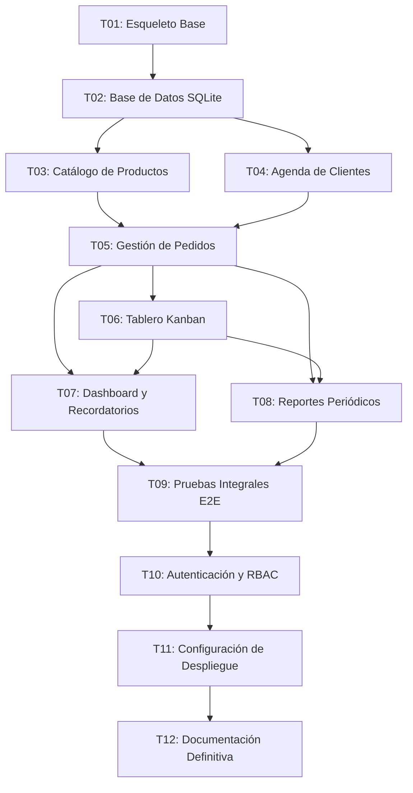

# 13 — Plan de Trabajo y Cronograma: Carolina Sweet

El desarrollo de Carolina Sweet se organizó en 12 tareas incrementales (T01 a T12) con verificación continua de pruebas y protocolo estricto de control de versiones:

---

## 1. Etapas y Tareas Ejecutadas

| Tarea | Título | Alcance Implementado | Estado |
|---|---|---|---|
| **T01** | Esqueleto y Configuración Base | Estructura de carpetas desacoplada, Express, Vite, scripts npm y health check | ✅ Completado |
| **T02** | Base de Datos SQLite y Esquema | Tablas relacionales en `node:sqlite`, claves foráneas, índices y semillas iniciales | ✅ Completado |
| **T03** | Catálogo de Productos y Categorías | CRUD de productos, categorías, alérgenos y conmutador táctil de disponibilidad | ✅ Completado |
| **T04** | Módulo de Clientes (Agenda) | Clientes habituales, notas de alergias, vinculación automática HU-02 y soft-delete | ✅ Completado |
| **T05** | Gestión y Creación de Pedidos | Congelamiento histórico de precios, cálculo de seña/saldo y edición solo en Pendiente | ✅ Completado |
| **T06** | Tablero Kanban y Transiciones | 4 columnas táctiles con select, confirmación de reapertura y depuración de cancelados | ✅ Completado |
| **T07** | Dashboard y Recordatorios | Métricas vivas de facturación y alertas automáticas por fecha (Hoy, Mañana, 3 días) | ✅ Completado |
| **T08** | Reportes Periódicos de Ventas | Filtros día/semana/mes/año, facturación de entregados y ranking de más vendidos | ✅ Completado |
| **T09** | Testing Integral y Casos Borde | Suite E2E completa del ciclo de vida del pedido con verificación de saldos y reglas | ✅ Completado |
| **T10** | Preparación de Autenticación y RBAC | Middleware modular de autenticación, usuario admin predeterminado y roles | ✅ Completado |
| **T11** | Configuración de Despliegue y Responsive | Detección de API dinámica, build para producción y verificación mobile-first | ✅ Completado |
| **T12** | Documentación y Cierre | README final, guía técnica y manual de despliegue | ✅ Completado |

---

## 2. Dependencias entre Módulos

