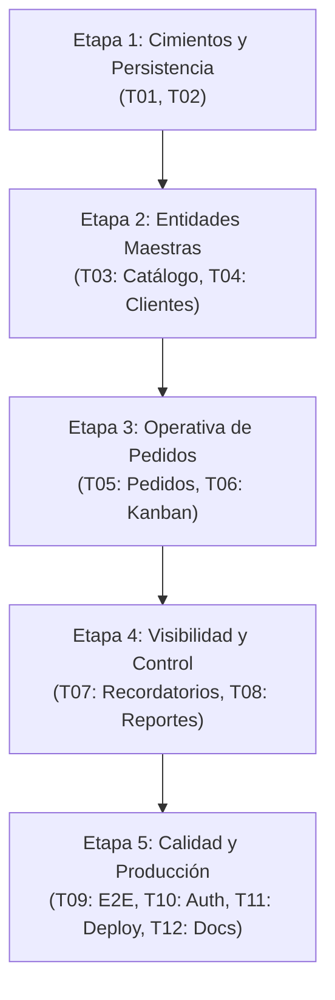

# Plan Estratégico de Desarrollo — Carolina Sweet

Este documento detalla la estrategia de ingeniería, el orden de construcción por módulos, las dependencias críticas y la justificación de prioridades adoptadas para construir **Carolina Sweet**.

---

## 1. Estrategia General de Desarrollo
El proyecto adoptó una estrategia de **desarrollo incremental guiado por especificación (SPEC-Driven Development) y validación continua**:
1. **Separación estricta de capas:** Frontend desacoplado (React/Vite), Backend modular (Express/SQLite) y comunicación mediante contratos JSON predecibles.
2. **Entrega orientada a valor (Valor al usuario primero):** Construir primero el núcleo de datos y persistencia, luego la operativa diaria (catálogo, clientes y pedidos), posteriormente la gestión visual (Kanban y alertas) y finalmente la inteligencia de negocio (reportes) y producción.
3. **Control estricto de versiones:** Ningún módulo se dio por concluido sin pruebas automatizadas verdes y confirmación explícita de Git por la responsable.

---

## 2. Orden de Construcción de Módulos y Justificación de Prioridades

### Etapa 1: Cimientos y Persistencia (Prioridad Alta - Bloqueante)
- **Módulos:** T01 (Esqueleto y AGENTS.md), T02 (Base de Datos SQLite y Esquema).
- **Justificación:** Es imposible registrar pedidos o clientes sin una base de datos relacional sólida que garantice tipos, índices y restricciones financieras.

### Etapa 2: Entidades Maestras (Prioridad Alta)
- **Módulos:** T03 (Catálogo de Productos y Categorías), T04 (Agenda de Clientes).
- **Justificación:** Un pedido en pastelería se compone de productos que se venden a clientas específicas. Tener estas entidades activas con soporte de alérgenos y precios es prerrequisito para armar un pedido.

### Etapa 3: Núcleo de Operaciones y Flujo Visual (Prioridad Alta)
- **Módulos:** T05 (Gestión de Pedidos y Congelamiento de Precios), T06 (Tablero Kanban Táctil).
- **Justificación:** Resuelve el dolor principal del negocio: centralizar los pedidos de WhatsApp y saber en qué estado de cocina se encuentra cada creación.

### Etapa 4: Visibilidad, Alertas y Métricas (Prioridad Media)
- **Módulos:** T07 (Dashboard y Recordatorios Dinámicos), T08 (Reportes Periódicos de Ventas).
- **Justificación:** Agrega inteligencia operativa: agrupa las entregas de Hoy y Mañana y permite a Carolina conocer su facturación real por período.

### Etapa 5: Consolidación, Seguridad y Entrega (Prioridad Final)
- **Módulos:** T09 (Testing Integral E2E), T10 (Preparación de Autenticación y RBAC), T11 (Configuración de Despliegue en la Nube), T12 (Documentación Oficial).
- **Justificación:** Asegura que el sistema esté libre de regresiones, preparado para crecer con usuarios y listo para ser desplegado en Render o Railway.

---

## 3. Matriz de Dependencias

| Módulo / Tarea | Dependencias Previas | Razón de la Dependencia |
|---|---|---|
| **T02: Base de Datos** | T01: Configuración base | Requiere el entorno Node y variables de configuración. |
| **T03: Catálogo** | T02: Esquema SQLite | Requiere las tablas `categories` y `products`. |
| **T04: Clientes** | T02: Esquema SQLite | Requiere la tabla `clients` e índices de teléfono. |
| **T05: Pedidos** | T03: Catálogo, T04: Clientes | Un pedido necesita productos activos y clientes a quién asociar. |
| **T06: Kanban** | T05: Pedidos | El tablero visualiza y transiciona los pedidos creados en T05. |
| **T07: Recordatorios** | T05: Pedidos, T06: Kanban | Las alertas filtran pedidos activos no entregados por fecha. |
| **T08: Reportes** | T05: Pedidos, T06: Kanban | Los reportes suman los pedidos que alcanzaron el estado `Entregado`. |
| **T09: Testing E2E** | T01 a T08 | Valida el ciclo completo de punta a punta entre todos los módulos. |
| **T10: Autenticación** | T01 a T08 | Protege las rutas existentes mediante middleware modular. |
| **T11: Despliegue** | T01 a T10 | Requiere la aplicación completa y testeada para compilar producción. |
| **T12: Documentación**| T01 a T11 | Consolida el manual definitivo y la arquitectura entregada. |
